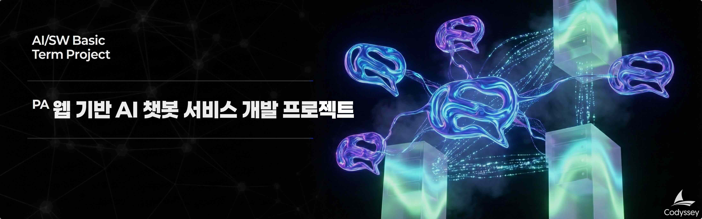

# B7-1: 웹 기반 AI 챗봇 서비스 개발 프로젝트

## 📋 과제 정보

| 항목 | 내용 |
|------|------|
| **과목** | Term Project (Term Project) |
| **난이도** | ★★★ (Lv.3) |
| **학습 시간** | 120분 |
| **필수 여부** | ✅ 필수 |
| **진행 상태** | - |
| **과제 번호** | 185017 |

---

## 🎯 미션 설명



---

## 🛠️ 개발 환경

### 5\. 개발 환경

*   Python & FastAPI로 구현한다.
*   SQLite 사용을 권장하며, 평가자가 확인 가능한 형태로 연결/조회가 가능해야 한다

---

## ⚠️ 제약 사항

### 6\. 제약 사항

*   **민감정보 및 설정 관리**
    *   API 키, DB 비밀번호 등 민감정보를 코드/문서에 직접 작성하지 않는다.
    *   모든 민감정보는 환경 변수(.env 등)로 관리한다.
    *   .env 파일은 저장소에 업로드되지 않도록 .gitignore를 적용한다.
    *   README에 환경 변수 키 목록(이름 수준)과 설정 방법을 포함한다.
*   **운영 안정성**
    *   AI API 호출은 타임아웃을 설정해야 하며(값은 팀이 선택), 실패 시 사용자에게 오류 안내를 반환해야 한다.
    *   요청 수신, AI 호출/응답, DB 저장 성공·실패가 로그로 남아야 한다.
*   **협업 규칙**
    *   PR 기반으로 머지하고, 브랜치/PR 기록이 저장소에 남아야 한다.
    *   팀원별 유의미한 커밋 최소 10회 이상 기록되어야 한다.
    *   기술 문서에 팀 구성원 역할 및 개인별 작업 요약을 반드시 포함해야 한다.

---

## 📝 결과 예시

### 7\. 결과 예시

아래는 정답이 아니라 참고 예시다. 실제 문구와 디자인은 얼마든지 달라도 된다.

*   웹 화면 예시 (대화 흐름)
    
    ```css
    (로그인 후)
    사용자: "내가 방금 뭘 물어봤지?"
    챗봇: "직전에 ‘배포 방법’을 물어보셨고, 저는 다음과 같이 답했습니다: ..."
    ```
    
*   에러 응답 예시 (타임아웃/실패)
    
    ```css
    사용자: "긴 글 요약해줘"
    챗봇: "현재 응답이 지연되고 있어요. 잠시 후 다시 시도해 주세요. (error: AI_TIMEOUT)"
    ```
    
*   서버 로그 예시 (핵심 이벤트)
    
    ```css
    INFO  request_received user_id=12 path=/api/chat
    INFO  ai_call_start user_id=12 request_id=abc123
    INFO  ai_call_success request_id=abc123 latency_ms=1240
    INFO  db_save_success user_id=12 chat_id=987
    ```
    
*   로그 조회 예시(형태 자유)
    
    ```css
    예시 1) 내 대화 로그 조회 API를 제공하는 경우
    - GET /api/me/chats
    - 응답에 질문/응답/시간이 포함되어 화면 또는 JSON으로 확인 가능
    
    예시 2) 확인용 SQL/스크립트를 제공하는 경우
    - scripts/check_logs.sql 실행 시 최근 대화 로그가 조회되도록 구성
    ```

---

## 📊 평가 정보

- 평가 대상: 예

---

> *이 문서는 Codyssey AI/SW 기초 과정의 과제 내용을 기반으로 자동 생성되었습니다.*
